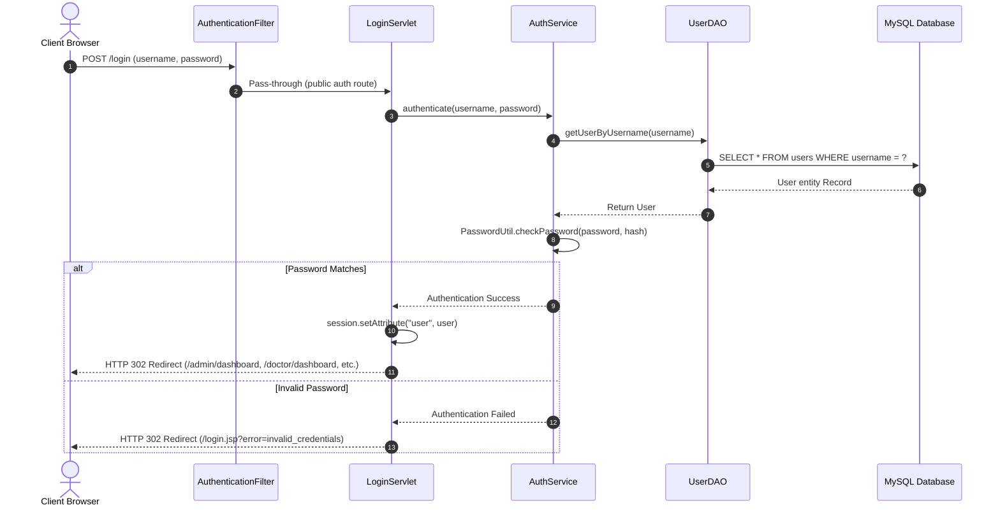
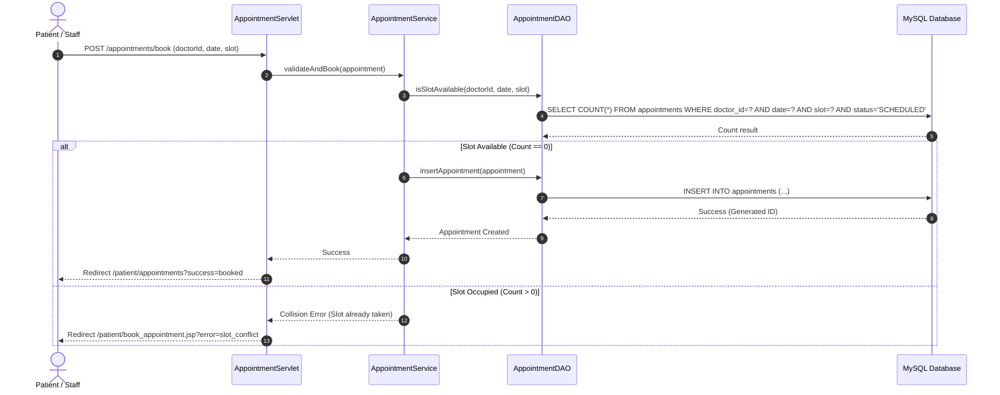

# System Architecture & Technical Design
## SmartCare — Smart Hospital Management System

> **Course / Program:** Java Web PBL 2026-27  
> **Team Nobita:** Devansh Mathur, Deepak Kumar, Hansraj Pandey, Aryan Daware, Devkinandan Kumawat  
> **Mentor:** Er. Ram Babu Buri  
> **Repository:** [https://github.com/mathurdevansh/Smart-Hospital-Management-System](https://github.com/mathurdevansh/Smart-Hospital-Management-System)

---

## 1. Architectural Overview

SmartCare is structured following the classical **Model-View-Controller (MVC)** architectural pattern adapted for enterprise Jakarta Servlet and JSP applications:

```text
[ Browser / Client ]
         │
         │ HTTP Request (GET / POST)
         ▼
┌─────────────────────────────────────────────────────────────┐
│ 1. Filter Layer (Security & Routing)                        │
│    ├─ AuthenticationFilter (Session Check & Static Exemption)│
│    └─ AuthorizationFilter (Role-Based URL Access Control)   │
└──────────────────────────────┬──────────────────────────────┘
                               │
                               ▼
┌─────────────────────────────────────────────────────────────┐
│ 2. Controller Layer (Jakarta Servlets)                      │
│    ├─ LoginServlet, LogoutServlet, RegisterServlet          │
│    ├─ AdminServlet, DoctorServlet, PatientServlet           │
│    ├─ AppointmentServlet, MedicineServlet, BillingServlet   │
└──────────────────────────────┬──────────────────────────────┘
                               │
                               ▼
┌─────────────────────────────────────────────────────────────┐
│ 3. Service Layer (Business Logic & Transactions)            │
│    ├─ AuthService (Credential Verification & Audit Logging)  │
│    ├─ AppointmentService (Collision Prevention & Slot Rules)│
│    ├─ BillingService (Invoice Calculation & Tax Aggregation)│
│    └─ AdmissionService (Room Allocation & Discharge Engine) │
└──────────────────────────────┬──────────────────────────────┘
                               │
                               ▼
┌─────────────────────────────────────────────────────────────┐
│ 4. Data Access Layer (DAOs) & Utilities                     │
│    ├─ UserDAO, PatientDAO, DoctorDAO, AppointmentDAO        │
│    ├─ MedicineDAO, BillingDAO, RoomDAO, VitalDAO            │
│    ├─ DBConnection (Connection Pooling & Resource Cleanup)  │
│    └─ PasswordUtil (jBCrypt Hashing) / ValidationUtil       │
└──────────────────────────────┬──────────────────────────────┘
                               │
                               ▼
┌─────────────────────────────────────────────────────────────┐
│ 5. Database Layer (MySQL 8.0)                               │
│    22 Normalized Tables (Aiven Cloud / Local MySQL)         │
└─────────────────────────────────────────────────────────────┘
```

---

## 2. Role-Based Access Control (RBAC) Matrix

The system enforces strict boundary isolation using `AuthorizationFilter`:

| Endpoint URL Pattern | Admin | Doctor | Patient | Nurse | Receptionist | Unauthenticated |
| :--- | :---: | :---: | :---: | :---: | :---: | :---: |
| `/login.jsp`, `/login`, `/register.jsp` | ✅ | ✅ | ✅ | ✅ | ✅ | ✅ |
| `/admin/*` (Departments, Users, Audit, Reports) | ✅ | ❌ | ❌ | ❌ | ❌ | ❌ (Redirect to Login) |
| `/doctor/*` (Consultation, Diagnosis, Records) | ❌ | ✅ | ❌ | ❌ | ❌ | ❌ (Redirect to Login) |
| `/patient/*` (Bookings, Bills, Prescriptions) | ❌ | ❌ | ✅ | ❌ | ❌ | ❌ (Redirect to Login) |
| `/nurse/*` (Record Vitals, Vitals History) | ❌ | ❌ | ❌ | ✅ | ❌ | ❌ (Redirect to Login) |
| `/receptionist/*` (Counter Booking, Billing) | ❌ | ❌ | ❌ | ❌ | ✅ | ❌ (Redirect to Login) |
| `/common/*` (Inventory, Invoices, Admissions) | ✅ | ✅ | ❌ | ✅ | ✅ | ❌ (Redirect to Login) |

---

## 3. Core Sequence Workflows

### 3.1 Authentication & Session Dispatch Flow


### 3.2 Appointment Booking & Collision Prevention Flow

